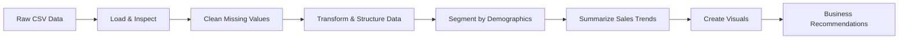
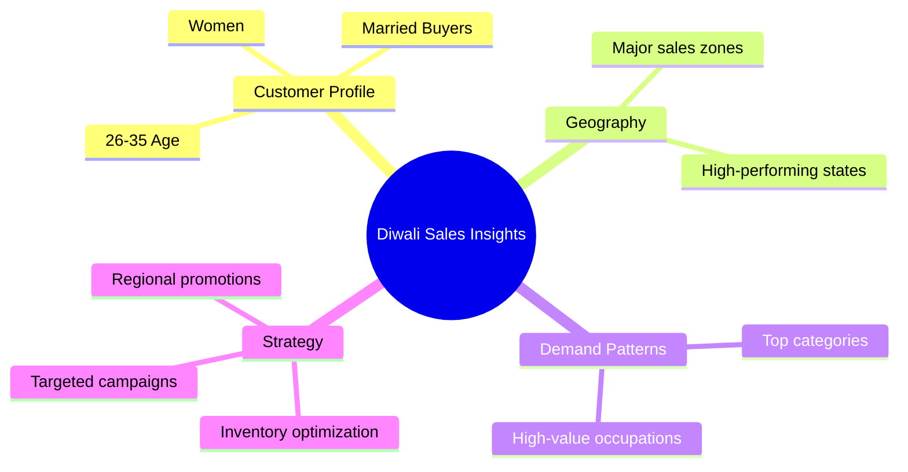
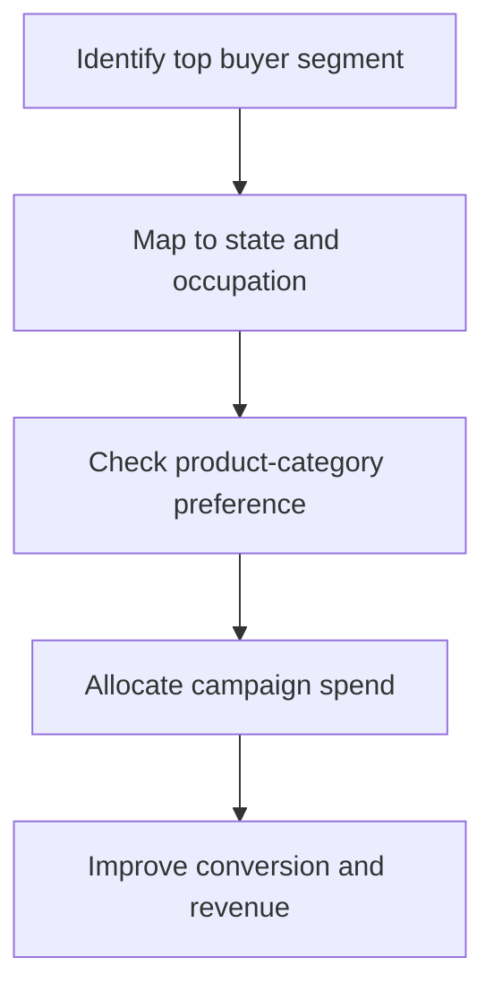

<div align="center">

# Diwali Sales Analysis

</div>

<p align="center">
  
</p>

<div align="center">


</div>

A data-driven retail analysis project focused on understanding how customers behave during the Diwali shopping season. The notebook explores customer demographics, purchase patterns, regional performance, and product demand to identify the highest-value audience segments and translate insights into actionable business recommendations.

## Why this project matters

Diwali is one of the biggest shopping events in India. Businesses need to know:

- Who is buying the most?
- Which age groups and customer segments drive the largest spend?
- Which states and zones contribute the highest revenue?
- Which product categories perform best?
- Where should marketing efforts and inventory be prioritized?

This project turns raw sales data into clear, visual, and actionable business intelligence.

## Project goal

The objective is to analyze Diwali sales data and uncover customer segments that contribute most to revenue, then suggest optimized marketing and sales strategies for future festive campaigns.

## Dataset overview

The project uses a sales dataset containing customer and transaction attributes such as:

| Column | Description |
|---|---|
| `User_ID` | Unique customer identifier |
| `Cust_name` | Customer name |
| `Product_ID` | Product identifier |
| `Gender` | Customer gender |
| `Age Group` | Age category |
| `Age` | Exact age |
| `Marital_Status` | Married or unmarried status |
| `State` | Customer state |
| `Zone` | Geographic zone |
| `Occupation` | Customer profession |
| `Product_Category` | Product family |
| `Orders` | Number of orders |
| `Amount` | Sales amount |

The raw dataset is stored in:

- `Diwali Sales Data.csv`

## Analysis pipeline



## Key analytical steps

1. Data loading with Pandas
2. Schema inspection and null checks
3. Removal of irrelevant or empty columns
4. Handling missing values in sales amounts
5. Data type normalization for analysis
6. Grouped sales analysis by:
   - Gender
   - Age group
   - Marital status
   - State / zone
   - Occupation
   - Product category
7. Visualization using Matplotlib and Seaborn
8. Interpretation of trends for strategic decisions

## Typical business insights this analysis uncovers

The notebook is designed to answer questions like:

- Female shoppers often dominate festival sales momentum in many retail datasets.
- Customers in the 26–35 age group contribute a large share of total spend.
- Married women become an important segment for festive demand.
- Certain states and zones drive the top revenue volumes.
- Product categories aligned with lifestyle, home, and consumer electronics tend to perform strongly during Diwali.

These insights help teams focus campaigns where conversion probability is highest.

## What the notebook visualizes

The analysis includes visual storytelling with charts such as:

- Gender-wise purchase distribution
- Age-group sales and order trends
- Marital status segmentation
- Regional sales contribution by state and zone
- Occupation-driven demand analysis
- Product-category performance comparison

A simplified view of the story is shown below:



## Example interpretation framework

The project follows a practical decision-making model:



## Recommended actions for business teams

Based on festive retail patterns, teams can use the analysis to:

- Prioritize campaigns toward the highest-converting customer segments
- Stock high-demand categories before the sales peak
- Increase local-targeted promotions in top-performing states
- Personalize promotional messaging for age and occupation groups
- Optimize digital ads around gender and lifestyle segmentation
- Plan inventory and staffing based on regional demand intensity

## Project structure

```text
Diwali Sales Analysis/
├── Diwali Sales Data.csv
├── Sales_Analysis.ipynb
├── README.md
└── .ipynb_checkpoints/
```

## Tech stack

- Python 3
- Jupyter Notebook
- Pandas
- NumPy
- Matplotlib
- Seaborn

## How to run

### 1) Install dependencies

```bash
pip install pandas numpy matplotlib seaborn jupyter
```

### 2) Launch the notebook

```bash
jupyter notebook
```

Then open `Sales_Analysis.ipynb` and run all cells.

## Data cleaning notes

The notebook includes a basic but important preprocessing flow:

- drop empty or non-useful columns
- handle missing values in `Amount`
- convert the sales value to a clean numeric format
- validate final dataset dimensions before visualization

This ensures the charts and segment summaries are trustworthy and presentation-ready.

## Business value

This project is useful for:

- retail analysts
- marketing strategists
- sales planning teams
- product managers
- business intelligence beginners learning EDA and storytelling with data

It demonstrates how exploratory data analysis can move from raw rows to real decision support.

## Insights summary

The result is a compact, high-impact view of Diwali customer behavior:

- Customer spending is strongly influenced by demographic segmentation.
- Data highlights a clear pattern of high-value purchase groups.
- Regional and occupational differences reveal where campaigns should focus.
- Product-category preferences guide inventory planning and merchandising.

## License

This project is intended for educational and analytical purposes. Reuse and adaptation are welcome for learning and portfolio use.

## Acknowledgements

This project uses a standard retail sales dataset for Diwali-based consumer analytics and demonstrates a real-world approach to exploratory data analysis in Python.

---

<p align="center">
  <strong>Built for insightful sales analysis and smarter festive demand planning.</strong>
</p>
